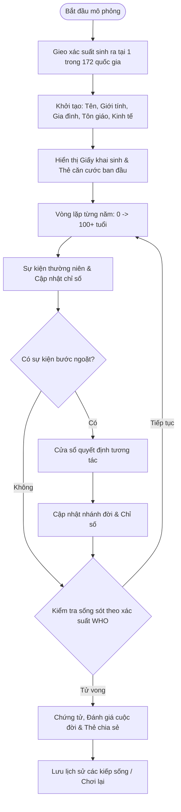

# Kế hoạch phát triển Clone Game: "1 in 8 Billion" (1n8b.life)

## 1. Tổng quan dự án

**1 in 8 Billion** (tên gốc tiếng Hàn: *80억 분 của 1*, web: *1in8b.life*) là trò chơi mô phỏng cuộc đời dạng văn bản tương tác gây sốt toàn cầu. 

Triết lý cốt lõi của trò chơi: **Mỗi giây có ~4.3 đứa trẻ chào đời trên Trái Đất. Không ai được chọn nơi mình sinh ra.** Khi người chơi bắt đầu, hệ thống sẽ "gieo xúc xắc" ngẫu nhiên dựa trên xác suất tỷ lệ sinh thực tế của **172 quốc gia** trên thế giới. Người chơi sẽ trải nghiệm cuộc sống từ sơ sinh đến khi qua đời, đối mặt với các biến cố, tỷ lệ tử vong trẻ em, cơ hội học tập, thu nhập, bệnh tật và đưa ra các lựa chọn quyết định vận mệnh.



---

## 2. Các tính năng cốt lõi (Core Features)

### 2.1. Động cơ xác suất dân số (Demographic Engine)
* **Phân phối tỷ lệ sinh thực tế:** Tỷ lệ sinh được cân bằng theo dữ liệu Liên Hợp Quốc (UN Population Division). Ví dụ: Ấn Độ (~17%), Trung Quốc (~8%), Nigeria (~6%), Việt Nam (~1.1%), Mỹ (~2.6%), các nước châu Âu (<0.5%).
* **Bộ dữ liệu 172 quốc gia:** Tích hợp đầy đủ các chỉ số thực tế:
  * Tuổi thọ trung bình ($LE$), chênh lệch nam/nữ ($gap$).
  * Tỷ lệ tử vong sơ sinh ($IM$) và dưới 5 tuổi ($U5$).
  * GDP bình quân đầu người ($PPP$), hệ số bất bình đẳng thu nhập ($Gini$).
  * Tỷ lệ biết chữ, số năm đi học kỳ vọng ($EYS$), tỷ lệ học đại học ($TER$).
  * Tỷ lệ kết hôn sớm ($CM$), tỷ lệ sinh ($TFR$), tỷ lệ tử vong sản phụ ($MMR$).
  * Rủi ro đặc thù: Dịch bệnh (Sốt rét, HIV), bạo lực, tai nạn giao thông, chiến tranh, thiên tai.
* **Tạo danh tính bản địa (Localization of Identity):**
  * Tên họ chuẩn văn hóa bản địa (Việt Nam: Nguyễn, Trần, Lê; Hàn Quốc: Kim, Lee, Park; Mỹ: James, Emma Smith; Ấn Độ: Aarav, Priya Sharma,...).
  * Thành phố ngẫu nhiên theo trọng số dân số (VD: Việt Nam: TP.HCM, Hà Nội, Đà Nẵng, Hải Phòng, Cần Thơ,...).
  * Tôn giáo và ngày lễ truyền thống phù hợp (Tết Nguyên Đán, Diwali, Giáng Sinh, Eid al-Fitr,...).

### 2.2. Vòng lặp mô phỏng & Chỉ số nhân vật
* **Bảng chỉ số (Vital Stats):**
  * **Sức khỏe (Health):** 0 - 100%. Bị tác động bởi dinh dưỡng thời thơ ấu, bệnh tật, hệ thống y tế quốc gia, thói quen sinh hoạt (hút thuốc, làm việc nặng).
  * **Hạnh phúc (Happiness):** 0 - 100%. Phụ thuộc vào gia đình, bạn bè, thành tựu, biến cố mất mát, môi trường sống.
  * **Tài chính (Wealth):** Tiền tệ quy đổi USD PPP và tiền tệ địa phương (VND, USD, KRW, EUR,...), phân cấp từ nghèo khó đến giàu có.
  * **Gia đình & Xã hội:** Cha mẹ, anh chị em, bạn đời, con cái, cháu chắt (có sinh có mất).
* **Lưới 100 năm cuộc đời (Life Grid):** Hiển thị trực quan 100 ô tượng trưng cho từng năm tuổi, đổi màu theo trạng thái sống/chết/bước ngoặt.
* **Nhật ký cuộc đời (Life Feed):** Ghi chép từng năm: sự kiện học tập, công việc, sở thích, tai nạn, tình yêu, biến cố xã hội.
* **Bộ điều khiển tốc độ:** Tạm dừng (Pause), 1x, 2x, 5x, 10x, hoặc chạy từng năm (Step-by-step).

### 2.3. Hệ thống quyết định tương tác (Interactive Dilemmas)
* Xuất hiện tại các mốc tuổi quan trọng (6 tuổi, 12 tuổi, 15 tuổi, 18 tuổi, 25 tuổi, 40 tuổi, v.v.):
  * *Tuổi thơ:* Chọn tập trung học hành, phụ giúp cha mẹ làm nông/buôn bán, hay trốn học chơi thể thao.
  * *Thiếu niên:* Chọn thi đại học, đi học nghề, hay xuất khẩu lao động.
  * *Trưởng thành:* Cơ hội di cư sang nước phát triển, kết hôn, đổi việc, kinh doanh mạo hiểm.
  * *Lựa chọn khó khăn:* Khi người thân bệnh hiểm nghèo trong gia cảnh túng thiếu.

### 2.4. Kết thúc & Vinh danh (Memorial & Shareable Card)
* **Giấy báo tử (Death Certificate):** Nguyên nhân tử vong cụ thể (bệnh lý tim mạch, tai nạn, tuổi già, sốt xuất huyết,...), số tuổi thọ đạt được so với tuổi thọ trung bình quốc gia.
* **So sánh thống kê:** *"Trong số 100 đứa trẻ sinh cùng năm tại [Quốc gia], bạn sống thọ hơn X% số người."*
* **Thẻ tóm tắt cuộc đời (Canvas Image Generator):** Tạo ảnh chân dung pixel/vector hoài niệm kèm thẻ căn cước có thể tải về hoặc chia sẻ mạng xã hội.
* **Lưu trữ tiền kiếp (Past Lives):** Lưu lại lịch sử các kiếp sống đã trải qua trong LocalStorage.

---

## 3. Kiến trúc kỹ thuật đề xuất

### Lựa chọn công nghệ
| Thành phần | Công nghệ đề xuất | Lý do lựa chọn |
| :--- | :--- | :--- |
| **Kiến trúc** | **Single Page Application (SPA)** | Chạy 100% Client-side, không cần máy chủ backend, tốc độ phản hồi tức thì, bảo mật dữ liệu riêng tư. |
| **Framework UI** | **React + Vite + TailwindCSS** (hoặc **Pure Modern Vanilla JS + CSS Tokens**) | Dễ bảo trì, giao diện chia component mạch lạc, Tailwind cho phép tái hiện thiết kế vintage/editorial tinh tế. |
| **Quản lý dữ liệu** | **JSON Dataset + Seeded RNG** | Dữ liệu 172 nước và cây quyết định được mô-đun hóa; RNG có seed giúp chia sẻ replay một cuộc đời cho bạn bè. |
| **Đồ họa / Thẻ ảnh** | **HTML5 Canvas API** | Render ảnh thẻ căn cước, bản đồ thế giới thu nhỏ và ảnh avatar chân dung không phụ thuộc thư viện nặng. |
| **Đa ngôn ngữ** | **I18n Engine (Hỗ trợ gốc Tiếng Việt, Tiếng Anh)** | Đáp ứng trọn vẹn người dùng Việt Nam với câu từ tự nhiên, cảm xúc. |

### Cấu trúc thư mục dự kiến
```
1in8b-clone/
├── index.html
├── package.json
├── src/
│   ├── assets/                # Icon, hình ảnh, font chữ cổ điển
│   ├── data/
│   │   ├── countries.json     # 172 quốc gia với đầy đủ chỉ số thống kê
│   │   ├── names.json         # Kho tên nam/nữ/họ theo từng ngôn ngữ/khu vực
│   │   ├── events.json        # Các sự kiện ngẫu nhiên theo độ tuổi và vùng
│   │   ├── decisions.json     # Cây lựa chọn tương tác
│   │   └── deathCauses.json   # Bảng nguyên nhân tử vong theo WHO
│   ├── engine/
│   │   ├── simulation.js      # Bộ máy tính toán xác suất & tiến trình từng năm
│   │   ├── probability.js     # Hàm cân bằng tỷ lệ sinh, rủi ro bệnh tật, tuổi thọ
│   │   └── avatar.js          # Thuật toán vẽ chân dung pixel theo giới tính/tuổi
│   ├── i18n/
│   │   ├── vi.json            # Bản địa hóa Tiếng Việt đầy đủ
│   │   └── en.json            # Bản địa hóa Tiếng Anh
│   ├── components/
│   │   ├── Hero.jsx           # Màn hình chào & nút "Tái sinh"
│   │   ├── BirthCard.jsx      # Thẻ khai sinh & thông tin ban đầu
│   │   ├── LifeDashboard.jsx  # Bảng điều khiển (Tuổi, thanh trạng thái, tốc độ)
│   │   ├── LifeFeed.jsx       # Dòng thời gian sự kiện
│   │   ├── LifeGrid.jsx       # Lưới 100 ô cuộc đời
│   │   ├── DecisionModal.jsx  # Cửa sổ lựa chọn tình huống
│   │   └── DeathSummary.jsx   # Màn hình tổng kết, chia sẻ thẻ ảnh
│   └── main.jsx
```

---

## 4. Lộ trình triển khai (Implementation Roadmap)

### Giai đoạn 1: Chuẩn bị dữ liệu & Động cơ xác suất (Foundation)
- [ ] Trích xuất và cấu trúc hóa toàn bộ bộ dữ liệu 172 quốc gia từ bản gốc (dân số, tỷ lệ sinh, GDP PPP, tuổi thọ, tỷ lệ tử vong trẻ sơ sinh).
- [ ] Xây dựng thuật toán chọn quốc gia ngẫu nhiên dựa trên phân phối tỷ lệ sinh thế giới (Cumulative Distribution Function).
- [ ] Xây dựng bộ sinh danh tính: Tên, họ, giới tính, thành phố, tôn giáo.

### Giai đoạn 2: Lõi mô phỏng cuộc đời (Simulation Core)
- [ ] Xây dựng cỗ máy thời gian (Time-step Loop): mỗi năm chạy qua các bước kiểm tra (Check sức khỏe $\rightarrow$ Rủi ro dịch bệnh/tai nạn $\rightarrow$ Giáo dục $\rightarrow$ Nghề nghiệp $\rightarrow$ Hôn nhân $\rightarrow$ Tuổi thọ).
- [ ] Tính toán xác suất tử vong theo độ tuổi (Infant Mortality ở năm 0-1, Under-5 Mortality ở năm 1-5, và đường cong tử vong theo WHO cho người trưởng thành/già).
- [ ] Điều khiển nhịp độ mô phỏng: Chạy tự động (1x, 2x, 5x, 10x), Tạm dừng, Tiếp tục.

### Giai đoạn 3: Hệ thống Lựa chọn & Sự kiện (Events & Decision Engine)
- [ ] Tạo hệ thống kịch bản lựa chọn (VD: học vấn năm 6-18 tuổi, di cư, khởi nghiệp, kết hôn).
- [ ] Gắn kết quả của sự lựa chọn vào biến số nhân vật (tăng/giảm tiền bạc, sức khỏe, nguy cơ rủi ro).

### Giai đoạn 4: Giao diện người dùng phong cách Tạp chí/Căn cước cổ điển
- [ ] Tái hiện phong cách thiết kế đặc trưng: Màu giấy cổ (`#EBF0ED`), chữ serif trang nhã, viền tem đóng dấu (`#0F6E68`), thẻ căn cước sinh tử.
- [ ] Xây dựng lưới 100 năm cuộc đời (Life Grid) và dòng thời gian trực quan (Life Feed).
- [ ] Tạo module vẽ avatar chân dung pixel hoặc ký họa theo lứa tuổi.

### Giai đoạn 5: Màn hình Kết thúc, Thẻ chia sẻ & Bản địa hóa Tiếng Việt
- [ ] Bảng tổng kết cuộc đời: Nguyên nhân mất, so sánh tuổi thọ phần trăm, di sản để lại.
- [ ] Render thẻ chứng nhận cuộc đời ra file ảnh PNG bằng Canvas để tải về hoặc share lên Facebook / TikTok / Instagram.
- [ ] Dịch thuật và trau chuốt toàn bộ nội dung sang **Tiếng Việt tự nhiên, giàu cảm xúc**.

---

## 5. Tiêu chí kiểm thử & Đánh giá (Verification)
1. **Kiểm tra tính chính xác của xác suất:** Chạy mô phỏng hàng loạt (Monte Carlo test 10,000 lần) để đảm bảo phân bố quốc gia sơ sinh khớp với tỷ lệ sinh thực tế của Liên Hợp Quốc (Ấn Độ ~17%, Việt Nam ~1.1%, v.v.).
2. **Kiểm tra tỷ lệ tử vong:** Các quốc gia có chỉ số $U5$ cao (như vùng cận Sahara) có tỷ lệ tử vong trẻ em cao thực tế; các nước phát triển có tuổi thọ trung bình 80+.
3. **Hiệu năng & Tương thích:** Chạy mượt mà 60 FPS trên cả điện thoại (iOS Safari, Android Chrome) và máy tính để bàn.
4. **Trải nghiệm ngôn ngữ:** Kiểm tra toàn bộ chuỗi văn bản Tiếng Việt không bị lỗi font, ngắt dòng chuẩn xác.
